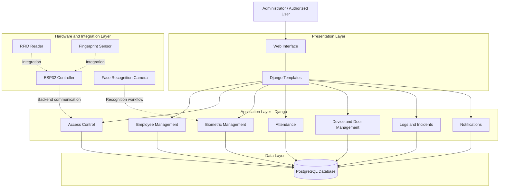

# Smart Access Control System (SACS)

**A Django and PostgreSQL-based Smart Access Control System for employee management, access authorization, attendance tracking, and security monitoring.**

---

## 1. Project Overview

The **Smart Access Control System (SACS)** is a web-based application designed to manage and monitor access to secured facilities.

The system provides centralized management of employees, departments, doors, access permissions, RFID cards, fingerprint records, face-recognition functionality, attendance, access logs, security incidents, and notifications.

SACS combines web application technologies with embedded-system concepts to support a flexible access-control environment.

## 2. Project Objectives

- Centralize employee and department management.
- Manage access permissions and authorization rules.
- Support multiple biometric and identification methods.
- Manage RFID cards and fingerprint records.
- Provide face-recognition functionality.
- Monitor attendance and access events.
- Maintain access logs and security incident records.
- Provide notifications for important system events.
- Support integration with embedded controllers and access-control hardware.

## 3. Key Features

### 3.1 Dashboard
- Centralized system overview.
- Employee, door, and device statistics.
- Attendance summaries.
- Access activity monitoring.
- Security information and system indicators.

### 3.2 Employee and Department Management
- Employee registration and management.
- Employee information and records.
- Department association and organization.
- Employee status management.

### 3.3 Access Control
- Access rules and authorization management.
- Door permission management.
- Access-granted and access-denied processing.
- Access event recording.

### 3.4 RFID Card Management
- RFID card registration and management.
- Card-to-employee association.
- Card status management.

### 3.5 Fingerprint Management
- Fingerprint record management.
- Employee fingerprint associations.
- Support for fingerprint-based identification workflows.

### 3.6 Face Recognition
- Face-recognition functionality.
- Face-template management.
- Employee-to-face-template association.
- Recognition result evaluation.

### 3.7 Device and Door Management
- Device registration and management.
- Door information management.
- Access-control infrastructure administration.

### 3.8 Attendance Management
- Employee attendance records.
- Attendance monitoring.
- Late-arrival information.
- Attendance reporting.

### 3.9 Logs and Security Monitoring
- Access event logging.
- Access history management.
- Security incident recording.
- Incident status management.

### 3.10 Notifications
- System notifications.
- Security-related notifications.
- Notification categorization and status management.

### 3.11 System Settings
- Centralized system configuration.
- Administrative settings management.

## 4. Technology Stack

| Category | Technologies |
|---|---|
| Backend | Python, Django 5.2 |
| API framework | Django REST Framework 3.16 |
| Database | PostgreSQL |
| Database driver | psycopg |
| Frontend | HTML, CSS, JavaScript |
| UI framework | Bootstrap 5 |
| UI icons | Bootstrap Icons |
| Image processing | Pillow |
| Authentication support | Django authentication, django-allauth |
| Administration interface | django-jazzmin |
| Data management | django-import-export |
| Environment configuration | python-dotenv |
| Web server support | Gunicorn, Waitress |
| Embedded systems | Arduino, ESP32 |
| Identification technologies | RFID, fingerprint, face recognition |

## 5. System Architecture

SACS is organized into four logical layers:

1. **Presentation layer:** Browser-based interface using Django templates, HTML, CSS, JavaScript, and Bootstrap.
2. **Application layer:** Django applications responsible for employee management, access control, attendance, devices, biometrics, incidents, and notifications.
3. **Data layer:** PostgreSQL database for persistent system information.
4. **Hardware and integration layer:** RFID readers, fingerprint sensors, ESP32 controllers, and other access-control components.

### High-Level Architecture



*Figure 1: High-level logical architecture of SACS. Hardware connections represent the intended integration architecture and do not imply that every physical connection is fully operational.*

## 6. Django Application Structure

The project is divided into 15 Django applications.

| Application | Responsibility |
|---|---|
| `access_control` | Access rules, authorization, and door permissions |
| `accounts` | User accounts and authentication |
| `attendance` | Attendance management |
| `dashboard` | Main dashboard |
| `departments` | Department management |
| `devices` | Device management |
| `doors` | Door management |
| `employees` | Employee management |
| `face_recognition` | Face-recognition functionality |
| `fingerprints` | Fingerprint management |
| `incidents` | Security incidents |
| `logs` | Access and system logs |
| `notifications` | System notifications |
| `rfid_cards` | RFID card management |
| `system_settings` | System settings |

## 7. Project Directory Structure

```text
Access_contol/
├── Config/
│   ├── asgi.py
│   ├── settings.py
│   ├── urls.py
│   └── wsgi.py
├── access_control/
├── accounts/
├── attendance/
├── dashboard/
├── departments/
├── devices/
├── doors/
├── employees/
├── face_recognition/
├── fingerprints/
├── incidents/
├── logs/
├── notifications/
├── rfid_cards/
├── system_settings/
├── DB/
├── static/
├── templates/
├── database_models.py
├── Manage.py
├── requirements.txt
├── .env.example
└── .gitignore
```

## 8. Database

SACS uses PostgreSQL as its relational database management system.

The database contains information associated with:

- Employees and departments.
- Devices and doors.
- RFID cards and fingerprint records.
- Face-recognition templates.
- Access rules and door permissions.
- Access logs and attendance.
- Security incidents and notifications.
- User accounts and system settings.

The project uses an existing PostgreSQL database schema. Database configuration and model management should be reviewed before attempting schema changes or migrations.

## 9. Hardware and Embedded Systems

The SACS architecture is designed to support hardware-assisted access control.

| Component | Intended role |
|---|---|
| ESP32 development board | Embedded controller |
| RFID reader | RFID card identification |
| R307 fingerprint sensor | Fingerprint acquisition and identification |
| ESP32-CAM / camera | Image acquisition for face recognition |
| Electronic door lock | Physical door access control |

### Hardware Integration Concept

1. An identification device obtains an access credential.
2. The embedded controller processes or forwards the identification information.
3. The backend evaluates the applicable authorization rules.
4. The system records the access event.
5. The physical access-control mechanism responds according to the implemented controller and firmware logic.

Physical device communication, door activation, sensor feedback, and error reporting depend on the corresponding firmware and hardware integration. These should be verified independently before deployment.

## 10. Installation and Setup

### Prerequisites

- Python 3.12 or later compatible with the project dependencies.
- PostgreSQL.
- Git.
- Visual Studio Code or another code editor.

### Step 1: Clone the Repository

```bash
git clone https://github.com/Jhonburte2244/smart-access-control-system.git
cd smart-access-control-system
```

### Step 2: Create a Virtual Environment

```bash
python -m venv venv
```

Activate on Windows PowerShell:

```powershell
.\venv\Scripts\Activate.ps1
```

### Step 3: Install Dependencies

```bash
python -m pip install --upgrade pip
pip install -r requirements.txt
```

### Step 4: Configure Environment Variables

Create a `.env` file in the project root using `.env.example` as a reference.

```dotenv
SECRET_KEY=replace-with-your-own-secret-key
DEBUG=True
DB_NAME=myproject_db
DB_USER=postgres
DB_PASSWORD=your-own-database-password
DB_HOST=localhost
DB_PORT=5432
```

Generate a unique Django secret key and use your own PostgreSQL credentials.

**Never publish your `.env` file or expose database credentials.**

### Step 5: Configure PostgreSQL

Create or configure the PostgreSQL database and ensure that the required SACS tables and schema are available.

The project may rely on an existing database structure. Do not run destructive database operations or migrations without first reviewing the models and database configuration.

### Step 6: Run Django System Checks

```powershell
python Manage.py check
```

### Step 7: Start the Development Server

```powershell
python Manage.py runserver
```

Open the application:

http://127.0.0.1:8000/

## 11. Main URL Endpoints

| URL prefix | Module |
|---|---|
| `/` | Dashboard |
| `/admin/` | Django administration |
| `/accounts/` | Accounts |
| `/employees/` | Employees |
| `/departments/` | Departments |
| `/access-control/` | Access control |
| `/attendance/` | Attendance |
| `/logs/` | Logs |
| `/rfid-cards/` | RFID cards |
| `/fingerprints/` | Fingerprints |
| `/devices/` | Devices |
| `/incidents/` | Incidents |
| `/notifications/` | Notifications |
| `/settings/` | System settings |
| `/face-recognition/` | Face recognition |

## 12. Screenshots

Screenshots will be added to demonstrate the actual application interface.

Suggested screenshots:

| Screenshot | Description |
|---|---|
| Dashboard | Main system overview |
| Employee Management | Employee records |
| Door Management | Registered doors |
| Access Control | Access rules and permissions |
| RFID Management | RFID card records |
| Fingerprint Management | Fingerprint records |
| Face Recognition | Face-recognition interface |
| Attendance | Attendance records |
| Access Logs | Access event history |
| Incidents | Security incident management |
| Notifications | Notification interface |

Planned image directory:

```text
docs/
└── images/
    ├── dashboard.png
    ├── employees.png
    ├── access-control.png
    ├── attendance.png
    ├── access-logs.png
    └── incidents.png
```

## 13. Security Considerations

- Store secret keys and database passwords in environment variables.
- Never commit `.env` files.
- Restrict access to administrative accounts.
- Use appropriate authorization checks for protected operations.
- Protect biometric information and employee records.
- Use HTTPS in production.
- Disable Django debug mode in production.
- Configure allowed hosts appropriately.
- Secure communication between embedded controllers and the backend.
- Back up the database regularly.

## 14. Current Development Status

SACS is an actively developed project.

The Django application, PostgreSQL connectivity, administrative modules, and core management interfaces form the software foundation.

RFID, fingerprint, face-recognition, and embedded-controller integration are part of the system's development and testing work. Their physical operation and end-to-end integration should be verified for the specific deployment environment.

## 15. Future Improvements

- Complete and validate end-to-end hardware integration.
- Improve embedded-controller communication.
- Add real-time access monitoring.
- Improve security auditing and reporting.
- Expand biometric verification workflows.
- Improve API documentation.
- Add automated testing.
- Prepare production deployment and monitoring.
- Improve backup and recovery procedures.

## 16. Author

**Yohannes Daksa**

System Software Developer | C/C++ | Embedded Systems | Python | Django | PostgreSQL

- GitHub: [Jhonburte2244](https://github.com/Jhonburte2244)
- Project repository: [Smart Access Control System](https://github.com/Jhonburte2244/smart-access-control-system)
- LinkedIn: [Yohannes Daksa](https://www.linkedin.com/in/jhonburte2014/)

---

**Project:** Smart Access Control System (SACS)
**Backend:** Python / Django
**Database:** PostgreSQL
**Status:** Active development
